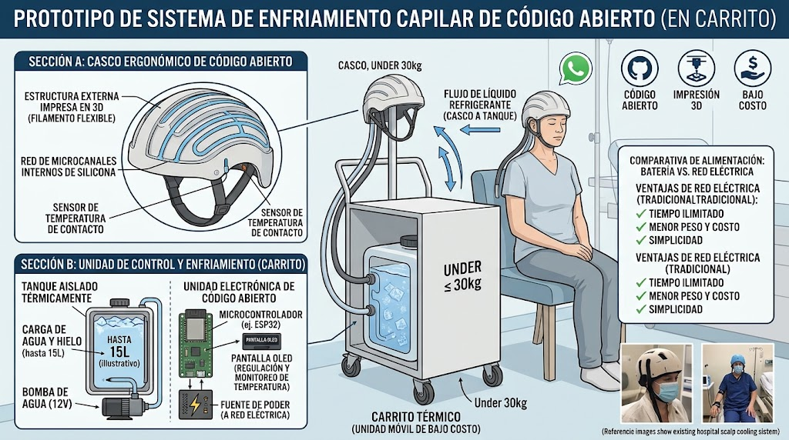
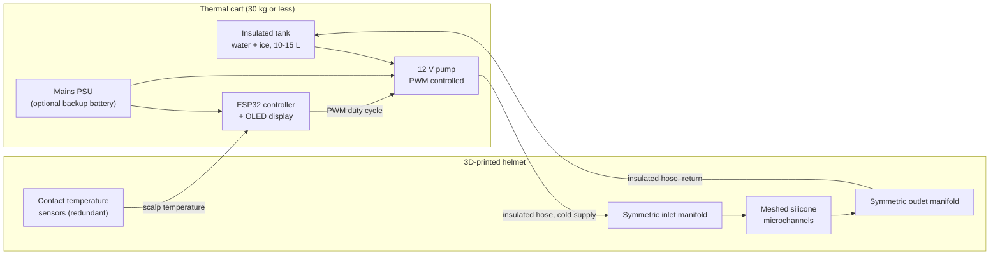

# ThermaScalp

**An open-source, low-cost, 3D-printable scalp cooling system to help prevent chemotherapy-induced hair loss.**

> **Important:** ThermaScalp is an early-stage engineering concept. It is **not a medical device**, has **not been
> tested on people**, and must not be used on patients. See the [disclaimer](#disclaimer) and
> [safety and regulatory notes](docs/safety-and-regulatory.md).

*Concept illustration (AI-generated, annotations in Spanish). An English version is on the [roadmap](ROADMAP.md).*

## The problem

Scalp cooling reduces hair loss during chemotherapy by cooling the scalp so that blood vessels constrict and less of
the drug reaches the hair follicles. It works for many patients, but access is poor:

- **Hospital scalp cooling machines** (Paxman, DigniCap and similar) are effective but expensive, bulky and
  unavailable in many clinics.
- **Frozen gel caps** are cheap, but a single session needs five or six caps. Patients and their companions have to
  carry them frozen to the clinic, and swap them roughly every 30 minutes for 4 to 6 hours. The caps start well below
  0 °C and warm up constantly, so the cooling is uneven and often uncomfortable.

The idea for this project came from watching a friend go through exactly that routine during breast cancer
chemotherapy.

## The idea

Replace the stack of frozen caps with a **continuous, actively regulated liquid loop**, built from cheap, standard
parts and open designs:

1. A **3D-printed flexible helmet** (TPU) with an internal **meshed network of silicone microchannels**.
2. A **thermal cart** (target: **30 kg or less**, on wheels) holding an insulated 10 to 15 L tank of ice water, a
   12 V pump, and an open-source controller.
3. **Insulated twin hoses** with quick-disconnect couplings joining the two.

Instead of refrigerating the fluid with a compressor, the **ice in the tank acts as a free cold reservoir**. An
ESP32-class microcontroller reads contact temperature sensors in the helmet and **doses the cold** by modulating the
pump, holding the scalp near a stable target (about 15 °C at the contact surface in the current concept).

## Key design decisions

| Decision | Choice | Why |
|---|---|---|
| Cooling source | Ice water in an insulated tank | No compressor, no refrigerant, low weight and cost |
| Form factor | Wheeled cart, 30 kg or less | Frees the design from hand-luggage limits and allows 10 to 15 L of thermal mass |
| Power | Mains via 12 V supply, with space for an optional backup battery | Unlimited runtime, lower weight and cost than a large battery |
| Control | Closed loop on scalp temperature, PWM or duty-cycled pump | Dose the cold instead of pumping near-0 °C water continuously |
| Helmet hydraulics | Meshed, symmetric, parallel channels with turbulence baffles | A single serpentine channel warms along its length and leaves hot spots |
| Fabrication | FDM printing (TPU) plus silicone, off-the-shelf electronics | Anyone with a printer and a soldering iron can reproduce it |

More detail: [Architecture overview](docs/architecture/overview.md).

*Meshed-path helmet architecture: inlet and outlet manifolds, multiple symmetric bifurcations and turbulence baffles
(AI-generated concept illustration, annotations in Spanish).*

## Repository map

| Path | Contents |
|---|---|
| [`docs/background.md`](docs/background.md) | Why scalp cooling works and how current options compare |
| [`docs/architecture/overview.md`](docs/architecture/overview.md) | System architecture, subsystems and interfaces |
| [`docs/architecture/thermal-control.md`](docs/architecture/thermal-control.md) | Control strategy, sensing and fail-safes |
| [`docs/architecture/helmet-hydraulics.md`](docs/architecture/helmet-hydraulics.md) | Meshed microchannel design for uniform cooling |
| [`docs/bom.md`](docs/bom.md) | Conceptual bill of materials |
| [`docs/safety-and-regulatory.md`](docs/safety-and-regulatory.md) | Hazards, standards and validation path |
| [`docs/open-questions.md`](docs/open-questions.md) | What is unknown and needs testing |
| [`hardware/`](hardware/README.md) | CAD, enclosure and schematics (planned) |
| [`firmware/`](firmware/README.md) | ESP32 controller firmware (planned) |
| [`ROADMAP.md`](ROADMAP.md) | Milestones from concept to bench prototype |

## Status

Concept stage: the architecture is defined and documented, and nothing has been built or measured yet. The numbers in
these documents (target temperatures, tank volume, flow rates, weight) are **design assumptions to be validated**, not
results. See the [roadmap](ROADMAP.md) for the plan.

## Contributing

Contributions are welcome from mechanical, electronics, firmware, thermal and clinical backgrounds, and from patients
and caregivers who know the real-world routine. Read [CONTRIBUTING.md](CONTRIBUTING.md) and open an issue to start a
discussion.

## Disclaimer

This project is provided for research and educational purposes under the [Apache License 2.0](LICENSE), without
warranty of any kind. It is not a medical device, is not approved by any regulatory authority, and has not been
clinically validated. Improper cooling can cause cold injury, and an untested device must never be used on a patient.
Anyone undergoing chemotherapy should talk to their oncology team about proven scalp cooling options.

## Acknowledgements

Inspired by Breast Cancer Awareness Day (19 October in Argentina) and by everyone carrying bags of frozen caps to
their chemotherapy sessions. The initial concept was explored in conversation with an AI assistant, and the
illustrations in this repository were AI-generated; both are meant as starting points to be corrected by real
engineering and clinical review.
