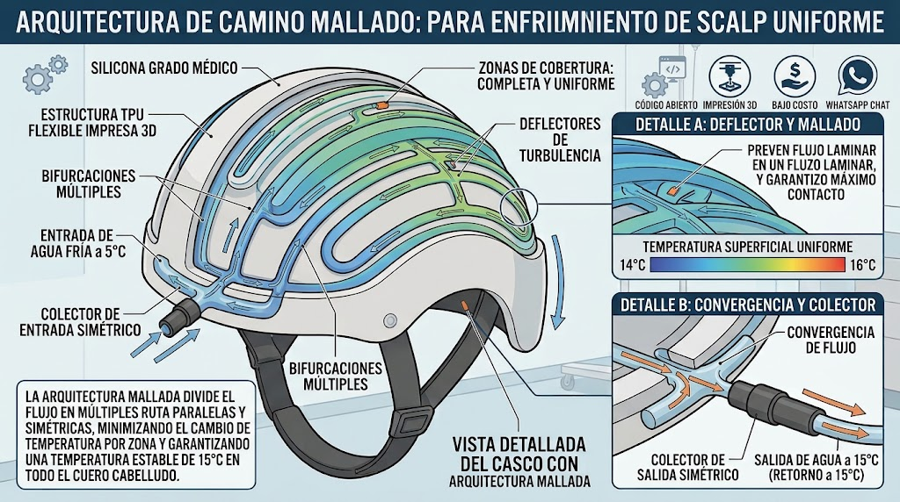
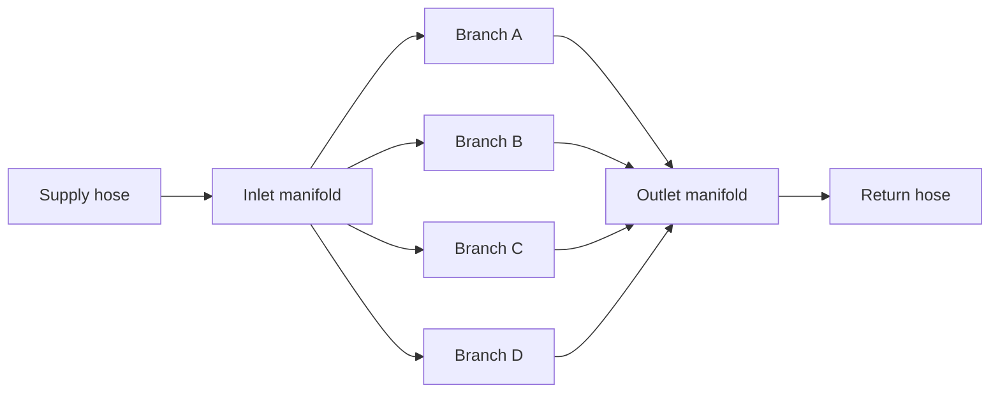

# Helmet hydraulics

## Why not a single serpentine channel

A single long channel looks simple, but cold water entering at one end warms steadily as it absorbs heat from the head.
By the end of the path the water is much warmer than at the start, leaving the scalp unevenly cooled with hot spots
exactly where protection is lost. The concept's source notes estimate an average of about 19.5 °C with hot spots for
the serpentine layout, against a target near 15 °C. (These numbers are illustrative and need CFD or bench confirmation.)

## Meshed-path architecture

The proposed design splits the flow into **parallel, symmetric paths** so that every region of the scalp sees water at
nearly the same temperature:

1. **Symmetric inlet manifold** receives the supply hose and splits flow immediately into several branches.
2. **Multiple bifurcations** divide flow further into a mesh covering the whole scalp.
3. **Equal length and resistance paths** ensure flow does not favour the path of least resistance.
4. **Turbulence baffles** inside the channels break up laminar flow, improving heat transfer to the channel wall.
5. **Symmetric outlet manifold** recombines the branches and returns the water to the tank.

## Design rules

| Rule | Reason |
|---|---|
| Keep parallel branches hydraulically equal (length, section, bends) | Prevents flow from short-circuiting through one path |
| Keep the temperature rise per branch small | Uniform surface temperature (target spread about 14 to 16 °C) |
| Use baffles to promote mixing, but watch pressure drop | A small 12 V pump has limited head |
| Keep the wall between fluid and skin thin and conductive enough | Heat transfer, while retaining comfort |
| Avoid sharp edges and pressure points | Comfort over a 4 to 6 hour session |
| Design for leak-tightness first | Water next to a patient's head and electronics |

## Materials

- **TPU (flexible filament):** outer shell, supports and manifold housings. Printed in sections to fit common print
  beds. Ordinary printed TPU should **not** be assumed to be skin-safe, watertight at microchannel scale, or suitable
  for prolonged clinical use (see [risks R-10 and R-11](../risk-register.md)). Fluid-carrying and skin-contact parts
  should be silicone tubing or molded silicone, and the first prototype may use a commercial cap or silicone interface.
- **Medical-grade silicone:** channel tubing or molded channels in contact with the skin side. Biocompatibility
  requirements for skin-contact materials apply (see [safety](../safety-and-regulatory.md)).
- Joint method (thermal welding, adhesive, overmolding) is an open question.

## Validation plan

1. Print a flat test coupon with candidate channel layouts and measure pressure drop and thermal uniformity with
   thermocouples.
2. CFD comparison of serpentine versus meshed layouts.
3. Instrumented **thermal dummy head** (heated, with temperature-dependent heat load) to test the full helmet.
4. Fit tests across head sizes with non-patient volunteers, only after safety review.
