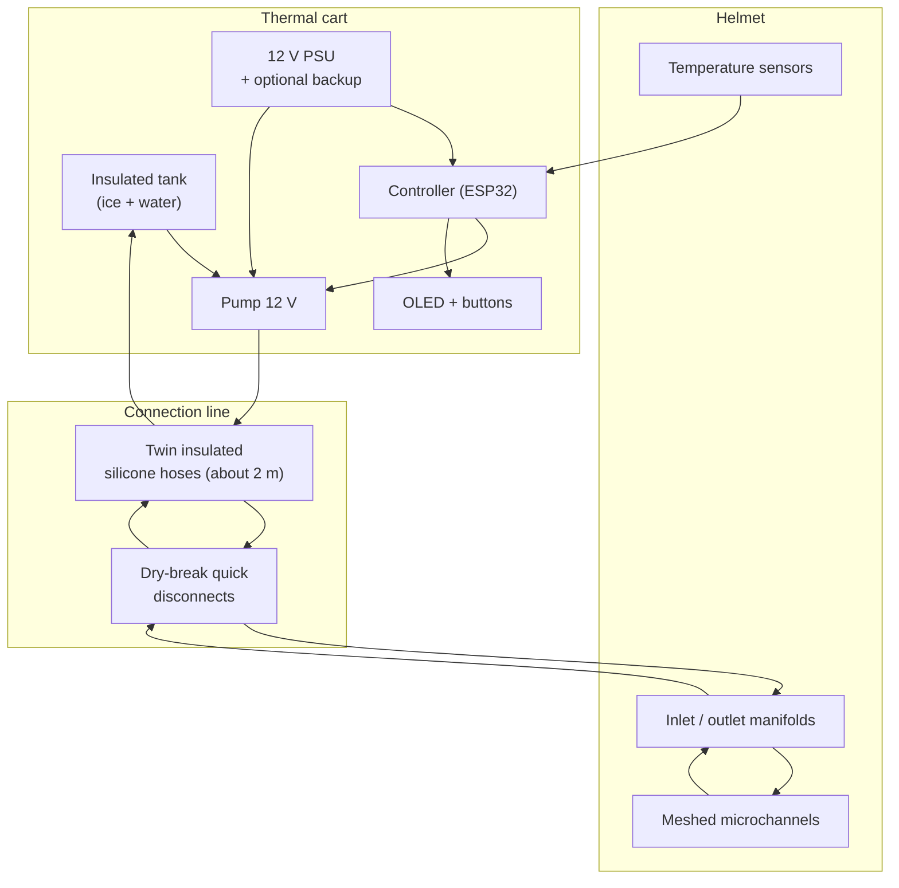

# Architecture overview

ThermaScalp is a closed-loop fluid system with three modules: the **helmet**, the **connection line** and the
**thermal cart**. Cold is stored as ice in the tank and metered to the helmet by a pump under closed-loop control.

## 1. Helmet

| Aspect | Concept |
|---|---|
| Shell | Flexible TPU, FDM printed in sections, designed in open CAD (FreeCAD / Fusion 360 exports) |
| Heat exchanger | Network of thin silicone channels (or printed TPU channels) bonded to the shell |
| Hydraulics | Symmetric inlet manifold, parallel meshed channels, turbulence baffles, symmetric outlet manifold |
| Sensing | Two or more waterproof contact temperature sensors at the scalp surface |
| Fit | Flexible material and adjustable strap to accommodate different head shapes |

Hydraulic details: [helmet-hydraulics.md](helmet-hydraulics.md).

## 2. Connection line

- Two silicone hoses (supply and return), about 2 m, wrapped in neoprene or foam insulation to limit heat gain from
  the room.
- Dry-break (self-sealing) quick disconnects so the helmet can be detached without spills.
- Sensor wiring routed with the hoses, with strain relief at both ends.

## 3. Thermal cart

Target total weight: **30 kg or less**, on a wheeled frame. Heavy items sit low for stability.

| Level | Contents |
|---|---|
| Lower | Insulated 10 to 15 L tank (expanded polyurethane or similar), submersible 12 V pump, ice and water |
| Upper / front panel | Sealed electronics box: ESP32, motor driver, OLED display, buttons, status indicators |
| Power | Mains to 12 V DC supply, reserved space for an optional 12 V backup battery |

Thermal mass is the key to the cart design. Water and ice absorb heat at 0 °C while melting, so 10 to 15 L of ice
water is intended to absorb the heat load of the head over a 4 to 6 hour session without refilling. Whether this holds
depends on the real heat load and ambient gains, which must be measured (see [open questions](../open-questions.md)).

## Power strategy

| | Mains (baseline) | Battery |
|---|---|---|
| Runtime | Unlimited | Limited by capacity |
| Weight and cost | Low | Higher |
| Complexity | Simple 12 V supply | Charging, protection, monitoring |
| Electrical isolation from the building | Provided by a certified isolated PSU | Inherent |
| Drawback | Needs a nearby outlet, cable on the floor | Must be charged beforehand |

**Decision:** design for mains power through a certified, isolated 12 V supply so the patient-side circuit is always
low voltage, and leave physical space and a power-path design for an optional backup battery.

## Subsystem interfaces

| Interface | Signal | Notes |
|---|---|---|
| Sensors to controller | 1-Wire (DS18B20) or analog (NTC / PT100 via ADC) | Redundant, plausibility-checked |
| Controller to pump | PWM into a logic-level MOSFET or motor driver | Flyback protection, hardware limits |
| Controller to UI | I2C OLED, GPIO buttons | Shows setpoint, scalp temperature, state and alarms |
| Helmet to hoses | Dry-break couplings | Standardize on one coupling size |

Control behaviour and fail-safes: [thermal-control.md](thermal-control.md).
