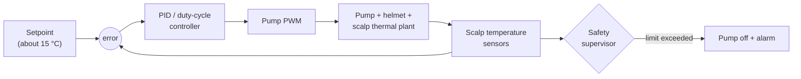

# Thermal control

## Principle

The tank is intentionally colder than needed (about 0 to 4 °C with ice). Pumping that water continuously would
over-cool the scalp, so the controller **doses the cold** instead of generating it:

- the **sensor** measures the real scalp contact temperature,
- the **controller** compares it to the setpoint (concept default: **15 °C**, band 14 to 16 °C),
- the **pump** is modulated to deliver more or less cold.



## Control modes

| Mode | Behaviour |
|---|---|
| Continuous PWM | Pump speed varies with a PID output; smoother, better for stable temperature |
| Duty-cycled | Pump runs for a fixed time then rests (for example 20 s on, 40 s off), simpler to implement |

Starting point: PID on PWM, with duty-cycle as a fallback mode. Tuning must be done on a thermal dummy head before any
other use.

## Session phases

| Phase | Typical duration | Controller behaviour |
|---|---|---|
| Pre-cooling | about 30 min | Ramp scalp temperature down to the setpoint at a limited rate |
| Infusion | varies | Hold setpoint |
| Post-cooling | 60 to 90 min | Hold setpoint, then end session |

The session timer, setpoint and alarms are shown on the OLED so a companion or nurse can monitor the system at a
glance.

## Sensing

- At least **two independent sensors** in the helmet at representative locations, with a plausibility check between
  them and against the fluid inlet and outlet temperatures.
- Candidates: DS18B20 (digital, waterproof probes, 0.5 °C accuracy class) or NTC thermistors with a calibrated ADC
  path. Final choice depends on accuracy and response time measured on the bench.
- Sensor fault (open circuit, short, out-of-range, disagreement) is treated as a **fault state**, never ignored.

## Fail-safes (design requirements)

These are requirements for the first prototype, not optional features:

1. **Over-cooling cut-off:** if any scalp sensor drops below a hard minimum, stop the pump and alarm.
2. **Independent hardware backstop:** a thermostat or comparator circuit that disables the pump regardless of
   firmware state, so a firmware crash cannot cause over-cooling.
3. **Sensor fault handling:** loss or disagreement of sensors leads to pump stop and alarm.
4. **Watchdog:** a hardware watchdog resets the controller on lock-up, with the pump defaulting to off.
5. **Leak and level detection:** tank level and a leak sensor in the electronics bay.
6. **Fluid temperature limit:** never allow the supply line below a safe minimum at the helmet.
7. **Audible and visual alarms**, with a clear indication of the current state.
8. **Safe default:** every undefined state results in the pump off.

Numeric limits are intentionally not fixed here: they need clinical input and bench validation, and are tracked in
[open questions](../open-questions.md).

## Firmware outline (planned)

```text
loop every 1 s:
    read sensors, validate (range, rate of change, agreement)
    if fault or limit exceeded: pump = OFF, raise alarm
    else: output = PID(setpoint - scalp_temp), clamp to [min_flow, max_flow]
    pump.pwm(output)
    log, update display
```

Firmware lives in [`firmware/`](../../firmware/README.md) once implementation starts.
